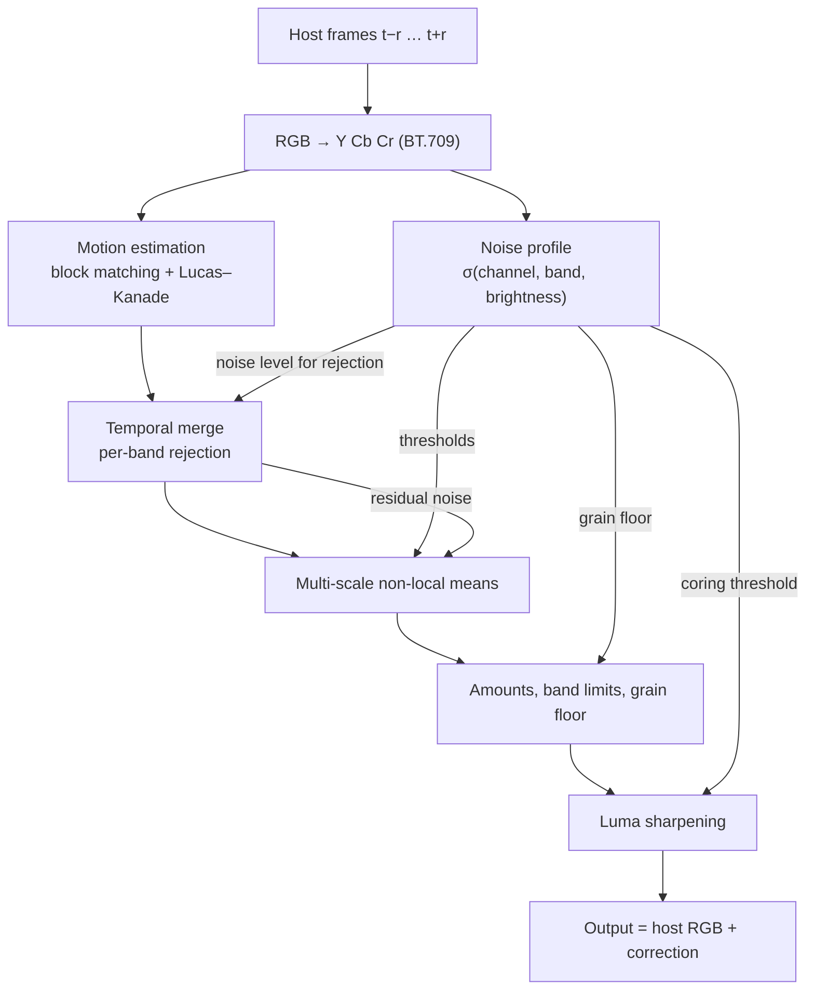
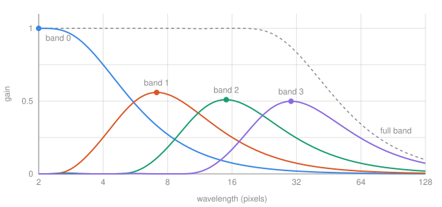
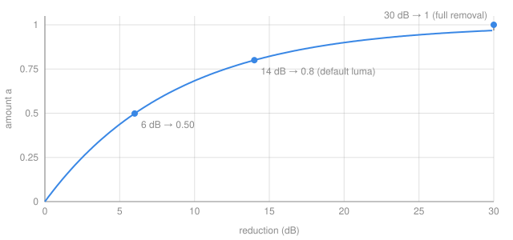

# Algorithm

Code: `core/src/session.mm` (pipeline), `core/src/stages/` and `core/shaders/`
(stages), `plugin/src/OpenDenoiseShared.mm` (controls → core parameters).

## Pipeline

Working space is BT.709 $Y$, $C_b=(B-Y)/1.8556$, $C_r=(R-Y)/1.5748$ on the
host's values, not linearised. The output adds the correction to the original
pixels; alpha is untouched.

## Noise model

The profile holds $\sigma_{c,b}(Y)$: 3 channels × 4 scale bands × 8 brightness
knots at $Y=l/7$, linearly interpolated, plus a full-band $\sigma$ per channel.

Bands come from the undecimated B3 à trous transform: $c_{b+1}$ is $c_b$
filtered with $[1,4,6,4,1]/16$ at tap spacing $2^b$, and $d_b=c_b-c_{b+1}$.
The bands overlap, so the full band $c_0-c_4$ is measured directly.

Each frame is cut into 32×32 tiles. Tiles with oriented structure, clipping or
dead pixels are discarded, and a robust noise floor is fitted against
brightness per channel and band. Where a neighbour frame exists, the frame
difference (energy halved) gives a second fit that also works on static
texture. The last 24 estimates are averaged (confidence-weighted
interquartile mean of $\log\sigma$); a fine-luma change above 1.35× marks a
new shot and restarts the average.

## Temporal merge

Up to 5 neighbours each side (default 2). Motion: hierarchical 8×8 block
matching on a luma pyramid, refined by Lucas–Kanade; Catmull–Rom warp. Cuts
and exact repeated frames are excluded.

Each difference $\delta_j=\mathrm{warp}(F_j)-F_0$ is split into a tent
pyramid. In band $b$, with $\beta_j$ the band of $\delta_j$:

$$
q_j=\left\langle \frac{\beta_j^2}{2\sigma_b^2} \right\rangle_{3\times3},\qquad
r_j=\mathrm{smoothstep}(2,5,q_j),\qquad
M_b=\frac{\sum_j (1-r_j)\,\beta_j}{1+\sum_j (1-r_j)}
$$

Pure noise gives $q\approx1$. Rejection also passes down from coarser bands
(×0.75), and a strong mismatch ($q$ 30–90) rejects fully at all finer bands,
which protects moving edges. The result is $F_0$ plus the collapsed $M_b$.

## Spatial filter

A tent pyramid ($[1,3,3,1]/8$, up to 5 levels) is filtered coarse to fine:
$X_k=G_k+U(\hat X_{k+1}-G_{k+1})$, $\hat X_k=\mathrm{NLM}(X_k)$.

Non-local means uses 3×3 patches and a 5×5 search. With $q$ the
noise-normalised patch distance:

$$
w=\exp\left(-\frac{\max(q-2,\,0)}{\eta}\right),\qquad \eta_Y=0.3,\quad \eta_C=0.5
$$

- $\sigma$ comes from the profile at the local brightness, times the user's
  corrections and $\sqrt v$ (below). Chroma uses $1.5\sigma$, guided by luma
  through $\max(0.25\,q_Y,\,q_C)$.
- The centre takes its best match's weight, so an unmatched pixel stays itself.
- An isolated pixel 4–12σ above (4–24σ below) its neighbours is treated as a
  speck. Brighter points are kept.

$v$ is the noise variance left by the temporal merge, per channel, level and
8×8 tile, from the raw band energy $E_r$ and the removed energy $E_d$:

$$
v=\mathrm{clamp}\left(1-\frac{E_d}{E_r},\ \left\langle n_{\mathrm{eff}}^{-1}\right\rangle,\ 1\right),
\qquad n_{\mathrm{eff}}=\frac{\left(1+\sum_j w_j\right)^2}{1+\sum_j w_j^2}
$$

On structure ($E_r$ 2–6× the profiled noise), $v$ falls back to the
$n_{\mathrm{eff}}$ bound.

## Amounts, grain floor, sharpening

$D$ dB of reduction sets the blend amount $a=1-0.2^{D/14}\approx1-10^{-D/20}$;
30 dB removes everything. Luma and chroma are separate, and per-band limits
scale the removed signal in bands 0, 1, 2 and ≥3.

The grain floor keeps at least $g$ of the existing luma noise. It generates
none. With $\sigma_Y$ the full-band luma sigma at the pixel's brightness:

$$
a_Y'=\min\left(a_Y,\ 1-\min\left(\frac{g}{\sigma_Y},\,1\right)\right),\qquad g=0.00075
$$

$g$ is 0.657 codes of 10-bit video range. *Finest grain* (default) caps band 0
of the removed signal only; *Whole picture* caps every band.

Sharpening is cored unsharp masking on luma bands $d_0$, $d_1$:

$$
Y'=Y+\sum_{b=0}^{1} g_b\,d_b\,\mathrm{smoothstep}(T_b,\,3T_b,\,|d_b|)
$$

$T_b$ is 2.5× the noise left in band $b$, so detail below the noise is not
amplified. The result is clamped to the local 3×3 range plus a halo allowance.
Chroma is not sharpened.

## Versions and precision

- **Version 2** (new effects) measures $v$ as above and refits a chroma
  profile that quantisation collapsed to zero. **Version 1** uses
  $n_{\mathrm{eff}}$ alone; it keeps older projects unchanged.
- **Fast** quality: one Lucas–Kanade step, 3×3 search at full resolution,
  sharpening on band 0 only, sparser profiling.
- Images are half float between stages and shaders mix float and half; the
  profile fit uses double. The pipeline is not 32-bit float throughout.
